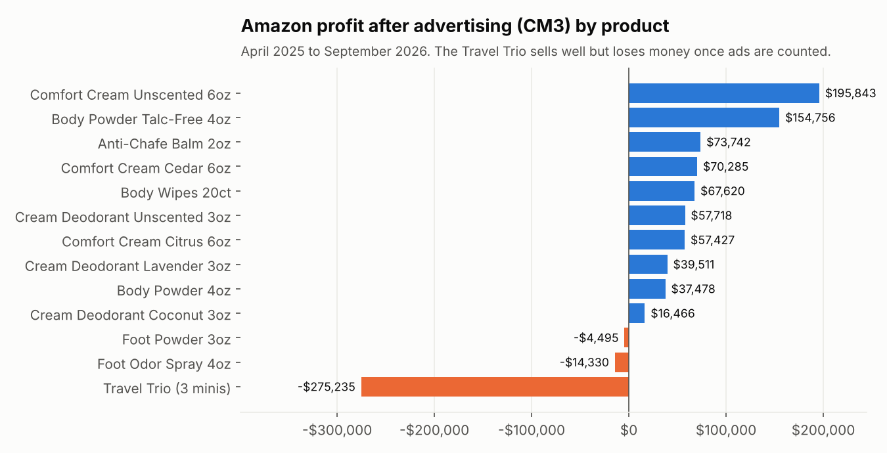
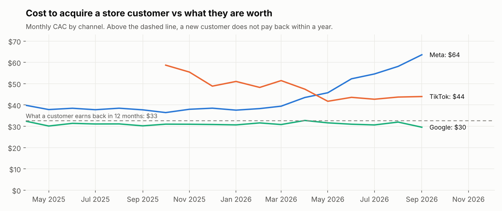
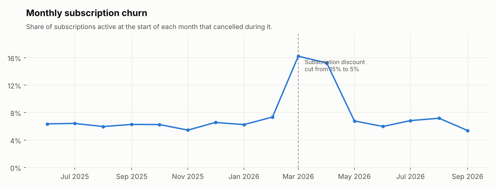
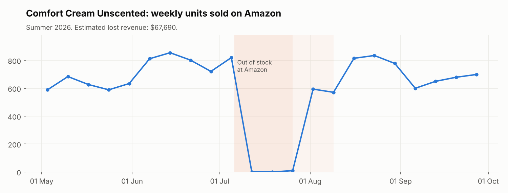

# E-commerce Profitability Analytics

Which products and channels actually make money once discounts, refunds, marketplace fees, shipping and advertising are counted, and where is the business losing money without noticing?

This project answers that for a fictional multi-brand body care company, **Freshkind Brands**, that sells sweat and odour care products (Brisk & Bold for men, Curvella for women, SoleFresh for feet) through its own Shopify store, with one-off orders and subscriptions, and on Amazon. Eighteen months of messy raw exports from Shopify, Amazon and four ad platforms go through a tested **dbt** pipeline into contribution margin (CM1 to CM3) by brand, channel and SKU, marketing reconciliation, customer lifetime value and segments.



## What it found (synthetic data, April 2025 to September 2026)

| Finding | Evidence | Recommended action |
| --- | --- | --- |
| **The store barely breaks even after advertising** | Store CM3 is 1% of net revenue against 13% on Amazon. A store customer earns back $33 (CM2) in their first 12 months, while Meta charged $39 to acquire one in early 2025 and $58 by mid 2026. Google stayed at about $31. | Shift budget from Meta towards Google and organic, and judge channels on CAC against 12-month customer value, not on platform ROAS. |
| **Subscribers are worth twice as much, and the discount cut drove them away** | Customers who ever subscribed earn back $58 in 12 months, against $27 for those who never did. Monthly churn averaged 6.4%, then hit 16.2% in March and 15.2% in April 2026, right after the subscription discount was cut from 15% to 5%. | Restore a meaningful subscription discount, or test one on new subscribers, and track churn weekly after any price change. |
| **A top seller loses money** | The Travel Trio is Amazon's second best seller by units (34,767), but after Amazon fees it makes $42,000 (CM2) and its ads cost $318,000: a $275,000 loss at CM3. SoleFresh products also lose money on Amazon after ads. | Raise the Trio's Amazon price or cut its ad spend; stop advertising SoleFresh on Amazon until its margin covers ads. |
| **A three-week stock-out over Prime Day** | Comfort Cream Unscented, the best seller, sold almost nothing on Amazon from 6 to 26 July 2026, then took two weeks to recover. Against the same weeks last year adjusted for growth, about 3,400 units and **$68,000** of revenue were lost. | Set a reorder point on Amazon FBA stock with a buffer ahead of Prime Day. |
| **A new product is making customers unhappy** | The Coconut cream, launched in February 2026, is refunded on 13.8% of units against a 3.5% median, mostly for scent (522 refunds) and irritation (516). | Review the formula with the product team before reordering. |
| **Ad platforms over-claim** | Meta, Google and TikTok together claimed $3.77 million of store revenue against $3.39 million the store actually recorded: 11% more than reality. | Report revenue from the store's own orders and use platform figures only to compare campaigns within a platform. |
| **Cash is sitting in slow stock** | Foot Powder has 39 weeks of warehouse stock; the median product has 7. | Pause reorders and use it in bundles or promotions. |



| Subscription churn | Amazon stock-out |
| --- | --- |
|  |  |

Customer segments, from `fct_customers`: one-time buyers are 52% of customers but 36% of lifetime CM2; active subscribers are 10% of customers and 19% of value. Full numbers are in [reports/findings.md](reports/findings.md).

## How the metrics are defined

| Metric | Definition |
| --- | --- |
| **Net revenue** | Gross product revenue minus discounts minus refunds, in US dollars (Canadian dollar orders converted at the monthly rate). Tax excluded |
| **CM1** | Net revenue minus cost of goods. Bundle cost is the sum of its components |
| **CM2** | CM1 minus Amazon referral and FBA fees, card payment fees, and store shipping cost net of shipping charged |
| **CM3** | CM2 minus advertising. Amazon campaigns are shared across the products they promote by sales; Meta, Google and TikTok spend is shared across store products by sales |
| **CAC** | Advertising spend on a platform divided by new customers whose first order came from it (last-click UTM) |
| **Customer value (LTV)** | Average CM2 per customer in their first 3, 6 or 12 months. Only customers whose full window has passed are counted, so new customers do not drag the average down |
| **Platform ROAS** | Revenue the platform claims divided by spend: the platform's own view, not verified |
| **TACoS / ACoS** | Amazon ad spend divided by all Amazon sales (TACoS: 25%), or by the sales Amazon credits to ads (ACoS: 27%) |
| **Churn** | Subscriptions cancelled in a month divided by those active at its start |

Two inputs the raw data does not contain are written down as **seeds** rather than hidden in code: store shipping cost ($5.40 per order plus $0.60 per extra unit) and card fees (2.9% plus $0.30). Change the seed and every margin updates.

## How it works

```
data/raw (15 exports)  ->  dbt staging (13 models)  ->  intermediate (5)  ->  marts (9)  ->  data/processed  ->  Power BI
                           clean and type each file     canonical SKUs,       margin, marketing,
                                                        costs, USD lines      customers, stock
```

| Layer | What happens |
| --- | --- |
| **Staging** | Every raw file is read as text and typed deliberately: two timestamp styles converted to the Eastern time business day, Amazon fees from negatives to costs, refunds from cents, Google cost from micros, the subscription flag written two ways, duplicates removed |
| **Intermediate** | One canonical SKU for every Amazon listing and old store SKU name; product costs including bundles; every product sold across both channels in US dollars with all its costs; refunds from both channels |
| **Marts** | `fct_contribution_margin`, `fct_marketing_monthly`, `fct_revenue_reconciliation`, `fct_subscriptions_monthly`, `fct_customers`, `fct_customer_ltv`, `fct_inventory_cover`, `fct_daily_sales`, and `meta_cleaning_log` |
| **Seeds** | Documented decisions: the store SKU rename, an old Amazon listing missing from the SKU map, cost assumptions, and which ad campaign promotes which products |

### Data quality

`dbt build` runs **76 checks** on every run, and `run_pipeline.py` stops if any fails. Beyond column checks, custom tests confirm that every Amazon listing has a canonical SKU, no test order reaches sales, the products in each order add up to its total, Amazon refunds are in dollars, CM3 equals net revenue minus every cost, all advertising is allocated, and the margin table matches the sales it was built from.

What the pipeline fixed, from `meta_cleaning_log`:

| Issue | Rows | Action |
| --- | --- | --- |
| Duplicate store orders from webhook retries | 1,144 | Kept one per order |
| Test orders | 35 | Excluded |
| Timestamps exported in UTC | 14,295 | Converted to the Eastern time business day |
| Orders in Canadian dollars | 4,267 | Converted with the monthly rate |
| SKUs in lower case or with trailing spaces | 8,193 | Standardised |
| Old store SKU name (before July 2025) | 2,849 | Mapped through a seed |
| Amazon orders on a listing missing from the SKU map | 8,013 | Mapped through a manual override seed |
| Cancelled Amazon orders | 5,653 | Excluded |
| Amazon refunds in cents | 8,389 | Divided by 100 |
| Refunds for orders before the data starts | 25 | Kept and flagged |
| Missing weekly warehouse counts | 26 | Left missing, not guessed |

Two problems the checks caught while building it:
- **A NULL comparison.** Every test passed but store revenue looked far too low. Orders with no discount code got a NULL test-order flag (`NULL = 'TESTING100'` is NULL, not false), so `where not is_test` silently dropped about 120,000 real orders. Fixed with `coalesce`, and a not-null test now guards the flag.
- **A time zone edge.** A reconciliation test found $671.61 missing: 35 Amazon orders placed just after midnight UTC on 1 April, which is still 31 March in Eastern time. The data was right; the test now uses the same reporting window.

## Run it

```bash
pip install -r requirements.txt
python scripts/generate_sample_data.py   # synthetic raw exports
python run_pipeline.py                   # dbt seed, dbt build (models and tests), export marts
python analysis.py                       # findings and charts
```

To browse the models and lineage: `cd dbt && dbt docs generate --profiles-dir . && dbt docs serve --profiles-dir .`

## Limits

- The data is synthetic. Costs, prices and rates were chosen to sit in realistic ranges for a DTC personal care brand, with changes built in so the pipeline could be checked; with real data, the same pipeline would measure them.
- Amazon does not share customer identities with sellers, so customer value and segments cover store customers only.
- CAC uses last-click attribution from UTM tags, which credits the final touch only.
- Shipping cost and card fees are assumptions held in a seed.

## A note on the data

All data is synthetic and every company, brand and customer is invented. `data/raw/_answer_key.json` records what the generator built in so the findings can be checked; the pipeline and analysis never read it, except for one line in `analysis.py` that prints it next to the stock-out estimate for comparison.

## Tech

dbt (DuckDB adapter, SQL that would port to BigQuery or Databricks), Python (pandas, matplotlib), DuckDB.
